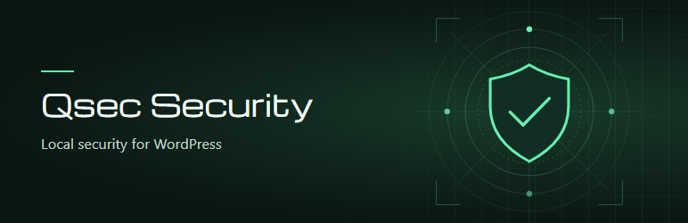
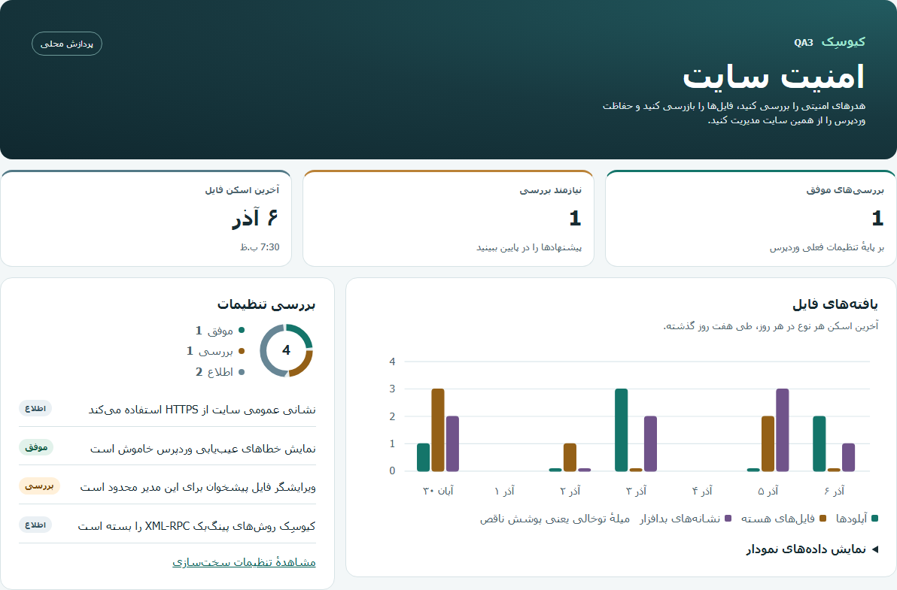

  
  <h1>کیوسِک</h1>
  
<strong>تأثیر تغییرات امنیتی وردپرس را پیش از اعمال آن‌ها بررسی کنید.</strong>

  
وردپرس ۶٫۶ به بالا · PHP ۸٫۳ به بالا · مجوز GPL-2.0-or-later

  
<a href="README.md">English</a> · <strong>فارسی</strong>

  

    <a href="https://github.com/qa3me/qsec/releases/latest"><strong>دانلود بستهٔ نصب</strong></a>
    · <a href="https://qsec.qa3.me/">سایت کیوسِک</a>
    · <a href="https://qsec.qa3.me/guide/index.html">راهنمای نصب</a>
  

## نمای پیشخوان

  

پیشخوان واقعی کیوسِک در وردپرس محلی با دادهٔ نمونه.

## ابزارهای امنیتی

- **فایروال با حالت اولیهٔ فقط گزارش.** درخواست‌های منطبق با مسیرهای مشخص فایل‌های پیکربندی یا مخزن کد را ببینید و در صورت نیاز مسدودسازی را روشن کنید. بررسی روی درخواست‌های عمومی `GET` و `HEAD` انجام می‌شود که به وردپرس می‌رسند.
- **پیش‌نمایش سیاست امنیت محتوا (CSP).** سیاست را روی یک صفحه در حالت فقط گزارش امتحان کنید. مبدأ منابعی را که مرورگر دیده و هدرهای پاسخ صفحه را پیش از اعمال سیاست بررسی کنید.
- **امنیت ورود.** آمار تجمیعی ورودهای ناموفق را ببینید و در صورت نیاز برای تلاش‌های ناموفق پشت‌سرهم وقفهٔ کوتاه بگذارید. طرح تیره، روشن یا هماهنگ با دستگاه با ورود و بازیابی رمز خود وردپرس کار می‌کنند. برنامهٔ رمزساز و کدهای بازیابی از طریق افزونهٔ جداگانهٔ [Two-Factor](https://wordpress.org/plugins/two-factor/) در دسترس‌اند.
- **یکپارچگی و بررسی فایل‌ها.** فایل‌های هسته را در دسته‌های ادامه‌پذیر با مرجع واردشدهٔ وردپرس مقایسه کنید. اسکن فایل‌های بارگذاری‌شده، افزونه‌ها و پوسته‌ها نشانه‌های مشکوک یا هش‌های منطبق با فهرست شما را گزارش می‌دهد. بررسی فایل‌ها فقط‌خواندنی است.

## نصب

۱. فایل ZIP نصب `qsec-security` را از [صفحهٔ انتشارها](https://github.com/qa3me/qsec/releases) بگیرید.  
۲. در وردپرس تک‌سایته به **افزونه‌ها ← افزودن افزونه ← بارگذاری افزونه** بروید، فایل را بارگذاری کنید و کیوسِک را فعال کنید.  
۳. به **تنظیمات ← کیوسِک** بروید و پیش از روشن‌کردن مسدودسازی، گزارش فایروال را مرور کنید.

رابط فارسی چیدمان راست‌به‌چپ و تاریخ شمسی دارد. کاربرد هر ابزار در [راهنمای فارسی پروژه](docs/PROJECT-fa.md) آمده است.

## حریم خصوصی

گزارش‌ها و اسکن فایل‌ها روی همان وردپرس پردازش می‌شوند. گزارش فایروال و گزارش اختیاری ورود، شمارش روزانه را نگه می‌دارند. محدودیت ورود برای نام کاربری و مبدأ درخواست از شناسهٔ رمزنگاری‌شدهٔ کوتاه‌عمر استفاده می‌کند. کیوسِک بدون حساب جداگانه، تله‌متری یا سرویس ابری کار می‌کند. خلاصهٔ اسکن‌ها را می‌توانید از پیشخوان پاک کنید.

## کد و پشتیبانی

برای بررسی محلی، با PHP ۸٫۳ به بالا فایل‌های PHP پوشهٔ [`tests/`](tests/) را اجرا کنید. آزمون‌های جاوااسکریپت با دستور `node --test tests/csp.test.cjs` در Node.js اجرا می‌شوند.

پرسش‌ها و اشکالات عادی را در [GitHub Issues](https://github.com/qa3me/qsec/issues) مطرح کنید. برای آسیب‌پذیری‌ها از مسیر خصوصی درج‌شده در [سیاست امنیتی](SECURITY.md#فارسی) استفاده کنید.

کپی‌رایت © ۲۰۲۶ **بهزاد قاسمی (QA3)**. کیوسِک با مجوز [GPL-2.0-or-later](LICENSE) و فونت Michroma با مجوز [SIL Open Font License](assets/michroma-ofl.txt) ارائه می‌شود.

