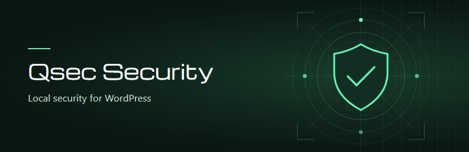
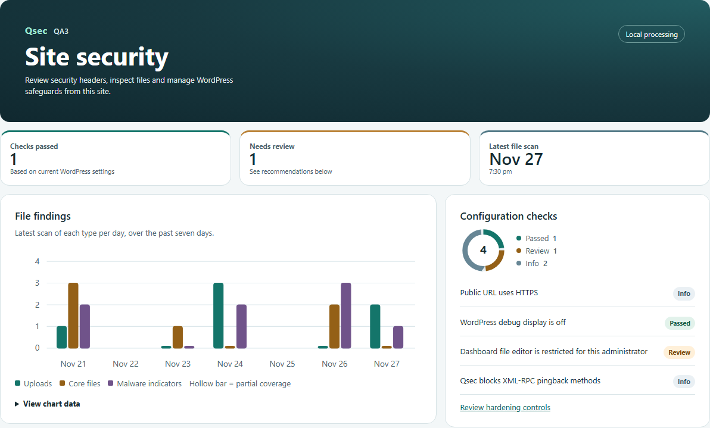

  
  <h1>Qsec Security</h1>
  
<strong>Review your WordPress security before enforcing changes.</strong>

  
WordPress 6.6+ · PHP 8.3+ · GPL-2.0-or-later

  
<strong>English</strong> · <a href="README.fa.md">فارسی</a>

  

    <a href="https://github.com/qa3me/qsec/releases/latest"><strong>Download the installer</strong></a>
    · <a href="https://qsec.qa3.me/en/index.html">Project website</a>
    · <a href="https://qsec.qa3.me/en/guide/index.html">Setup guide</a>
  

## Inside the dashboard

  

Qsec running on a local WordPress installation with sample data.

## Security controls

| Control | What you can do |
| --- | --- |
| **Report-first firewall** | Review matches on selected configuration and version-control paths. Then choose report only, block and report, or off. Checks cover public GET and HEAD requests that reach WordPress. |
| **Content Security Policy preview** | Preview a policy in report-only mode on a selected page. Inspect the resource origins the browser observed and the headers the page returns before adopting a policy. |
| **Login protection** | Review aggregate login failures and optionally enable a short cooldown for repeated password failures. Use the dark, light, or system theme with native WordPress login and recovery. Authenticator apps and recovery codes are available through the separate [Two-Factor plugin](https://wordpress.org/plugins/two-factor/). |
| **File integrity and inspection** | Compare core files against an imported WordPress checksum reference in resumable batches. Inspect uploads, plugins, and themes for suspicious indicators or matches against hashes you provide. Inspection is read-only. |

## Install

1. Download the `qsec-security` installer ZIP from [Releases](https://github.com/qa3me/qsec/releases).
2. In single-site WordPress, go to **Plugins → Add New Plugin → Upload Plugin**. Upload the ZIP and activate Qsec Security.
3. Open **Settings → Qsec** and review the firewall report before enabling optional blocking.

The English and Persian interfaces include a right-to-left layout and Jalali dates in Persian. See the [project guide](docs/PROJECT-en.md) for how to use the controls.

## Privacy

Qsec processes reports and file checks on your WordPress site. Firewall and optional login reports keep daily totals. The cooldown uses a short-lived keyed identifier for the login name and request source. Qsec runs without a Qsec account, telemetry, or a cloud service. Scan summaries can be cleared from the dashboard.

## Source and support

The local checks need PHP 8.3+ and Node.js. Run each PHP script in [`tests/`](tests/) and `node --test tests/csp.test.cjs`.

Use [GitHub Issues](https://github.com/qa3me/qsec/issues) for questions and ordinary bug reports. For vulnerabilities, see the [security policy](SECURITY.md).

Copyright © 2026 **Behzad Qasemi (QA3)**. Qsec is distributed under [GPL-2.0-or-later](LICENSE). Michroma is distributed under the [SIL Open Font License](assets/michroma-ofl.txt).
